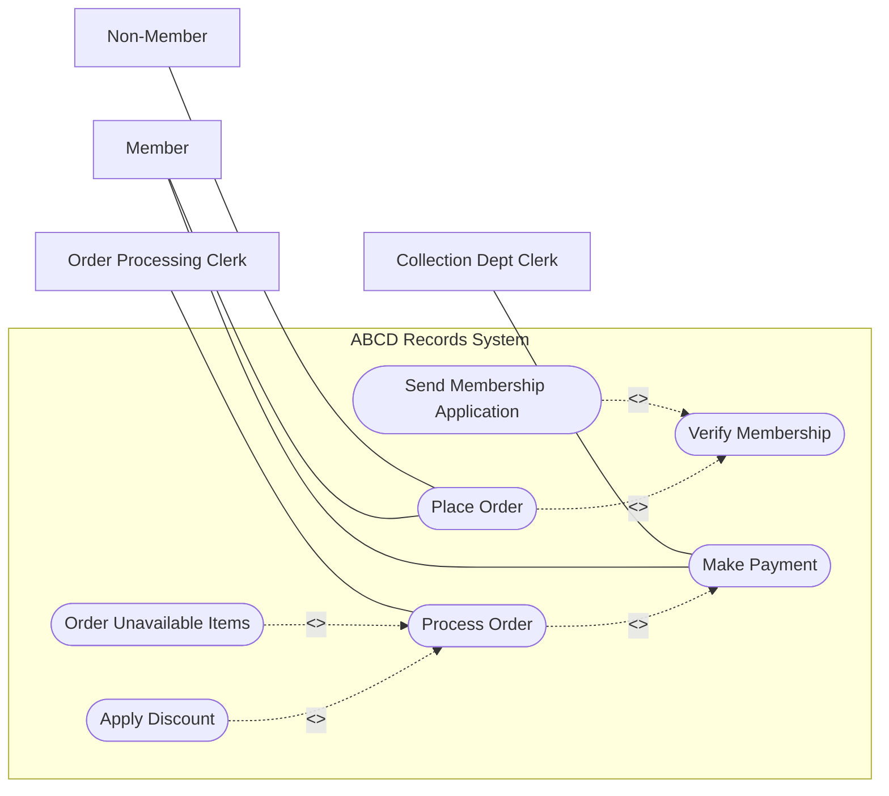
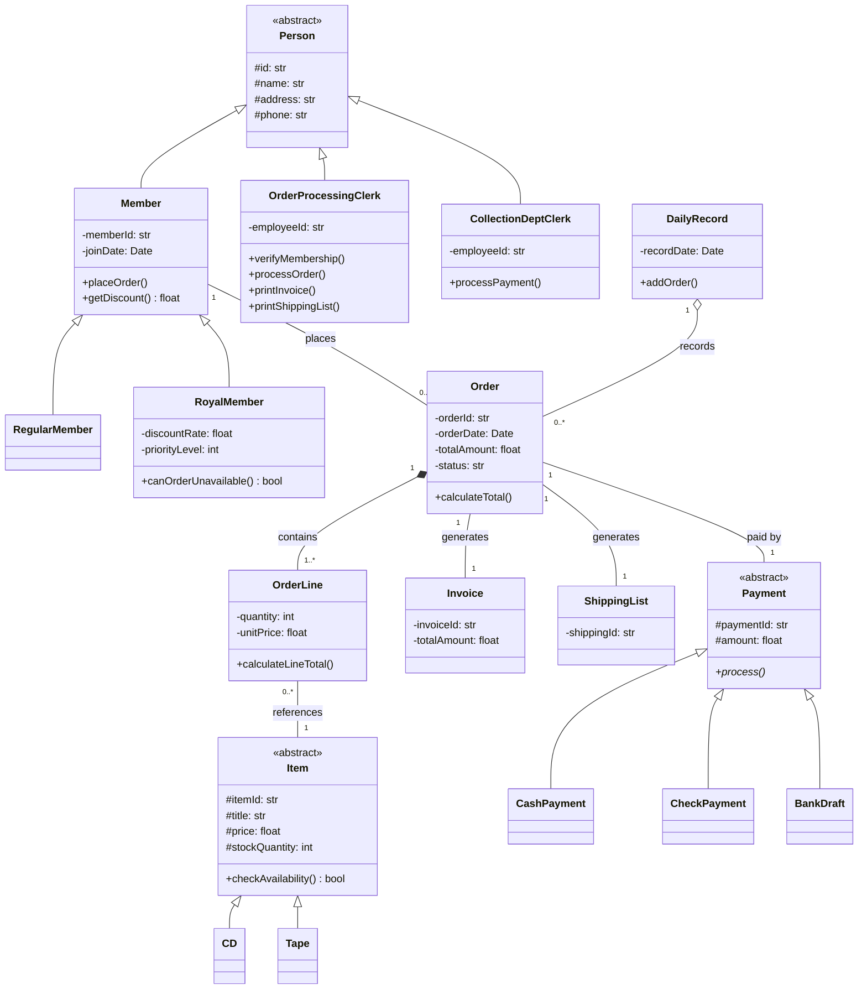
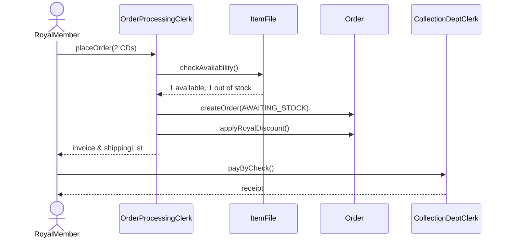
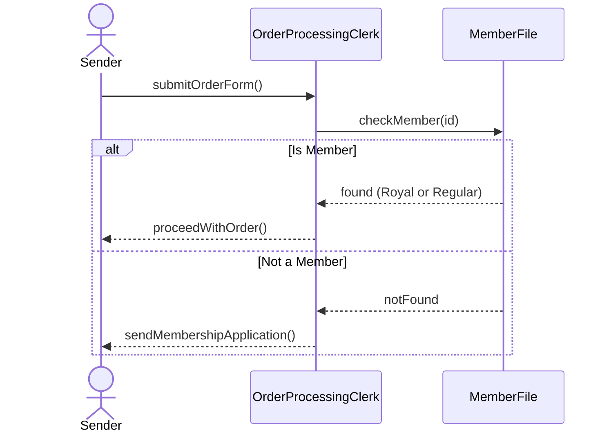

# Exo 2 - ABCD Records

## Use Case Diagram (Level 1 & 2)

## Complete Class Diagram (Level 2)

## Sequence Diagrams (Level 2 & 3)

### Scenario: Royal Member Orders 2 CDs (1 Unavailable) & Pays by Check

### Membership Verification (Success & Failure)

