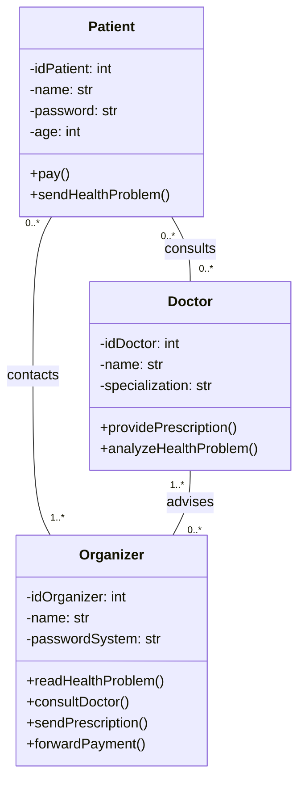
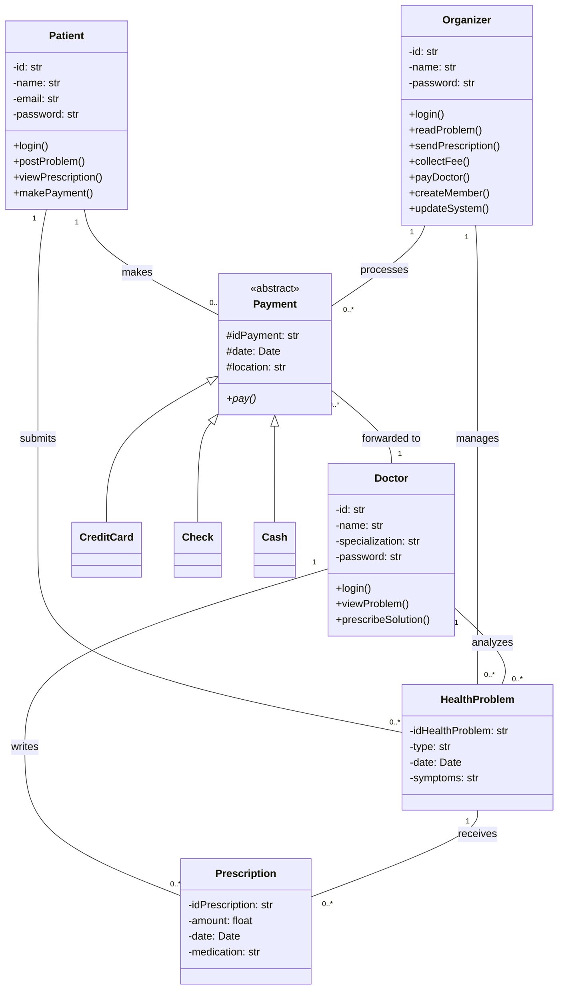
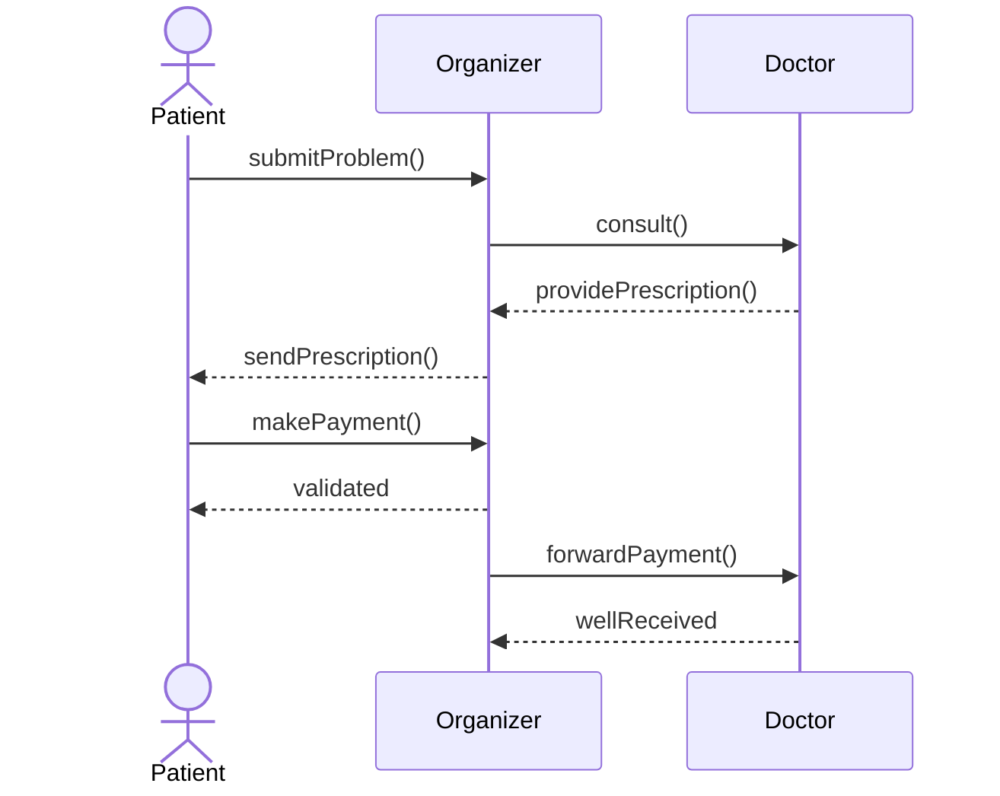
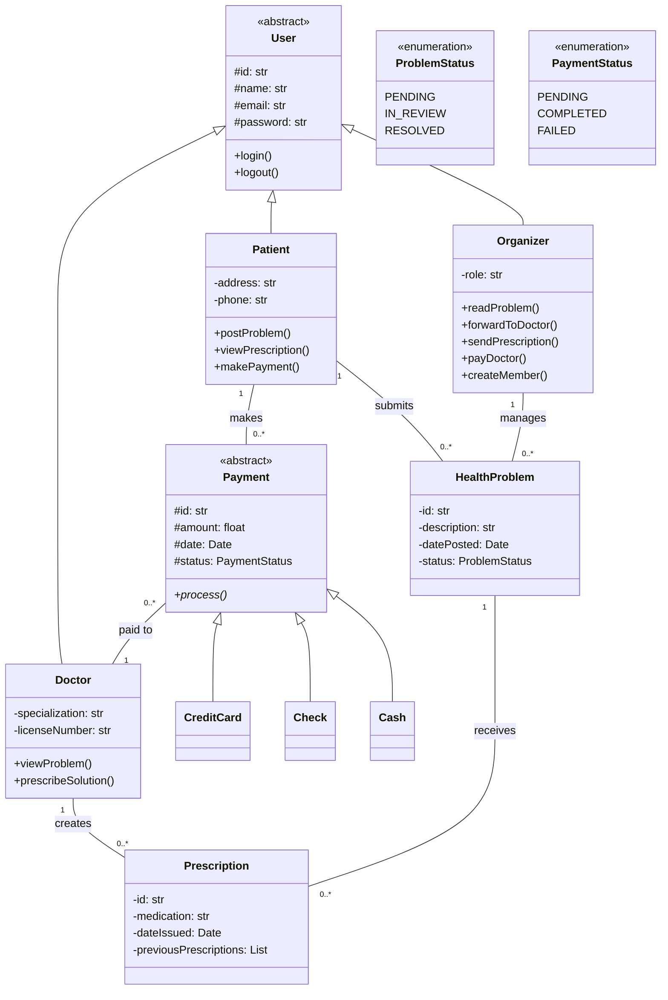
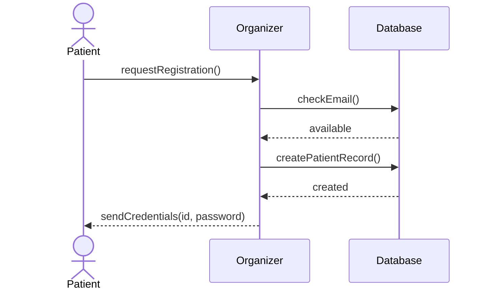
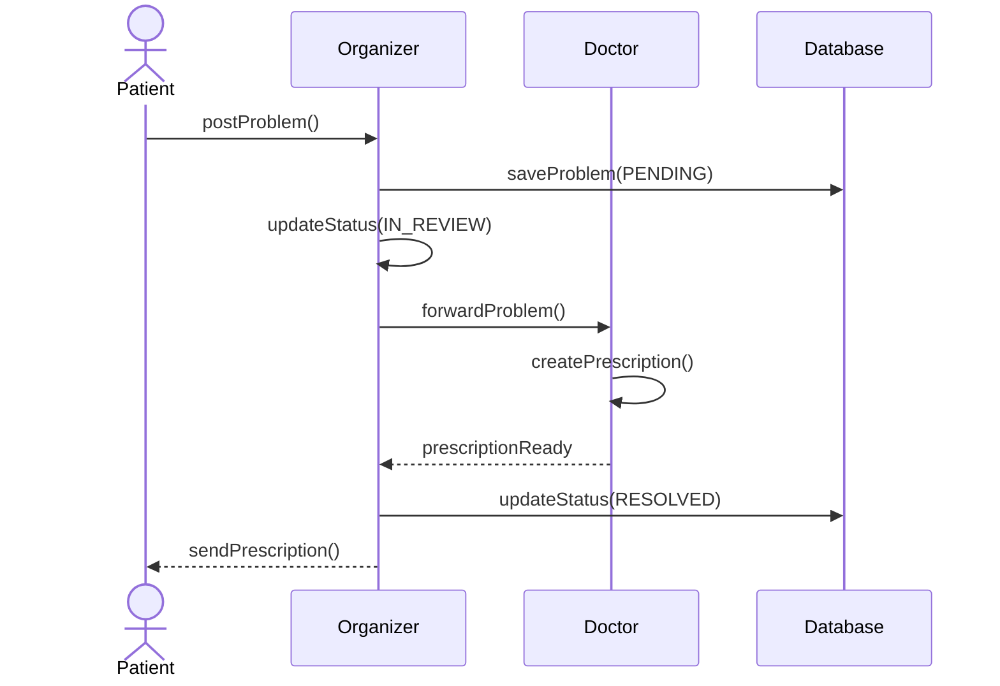
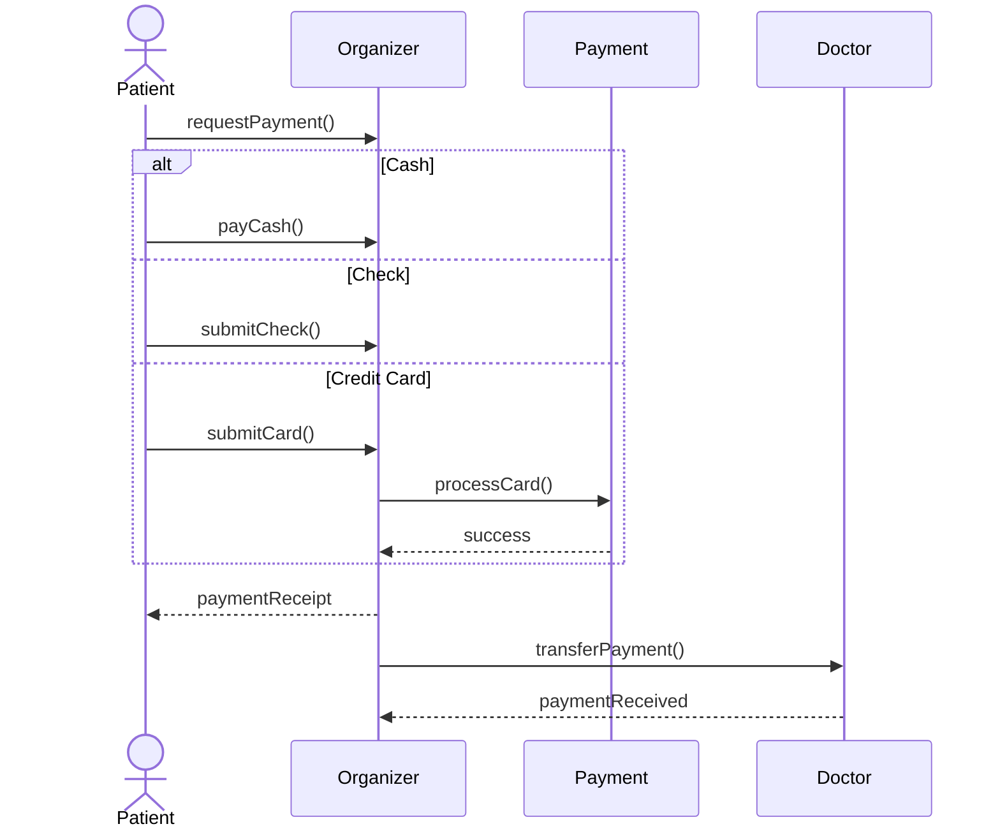

# Exo 1 - Hospital Management System

## Task 1 - Basic Class Diagram
Patient submits health problems, Organizer acts as intermediary and consults Doctor.

## Task 2 - Complete Class Diagram & Sequence Diagram

## Task 3 - Advanced Class Diagram & System Sequence Diagrams

### 1. Patient Registration

### 2. Consultation Flow

### 3. Payment Processing

